

GreenMart

---
###  Welcome Screens
<table align="center">
  <tr>
    <td align="center">
      <b>Splash Screen</b>  
      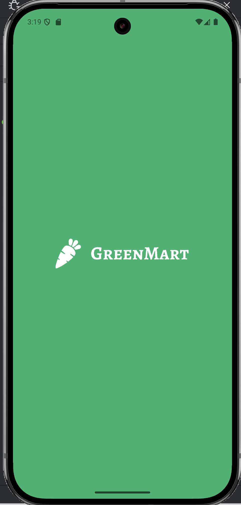
    </td>
    <td align="center">
      <b>Welcome Screen</b>  
      
    </td>
  </tr>
</table>
###  Authentication Screens
<table align="center">
  <tr>
    <td align="center">
      <b>Login Screen</b>  
      
    </td>
    <td align="center">
      <b>MobileNum Screen</b>  
      
    </td>
    <td align="center">
      <b>VeriCode Screen</b>  
      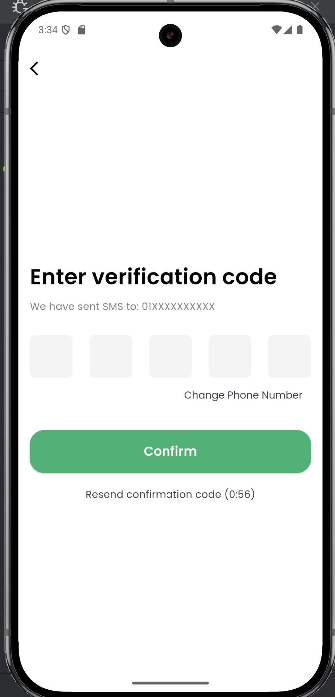
    </td>
    <td align="center">
      <b>VeriCode2 Screen</b>  
      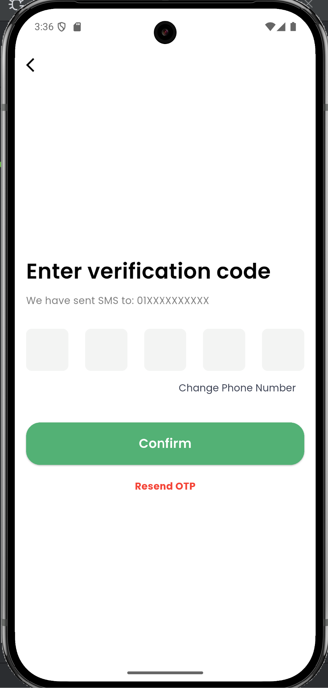
    </td>
  </tr>
</table>

---
###  Shop Screens
<table align="center">
  <tr>
    <td align="center">
      <b>Shop1 Screen</b>  
      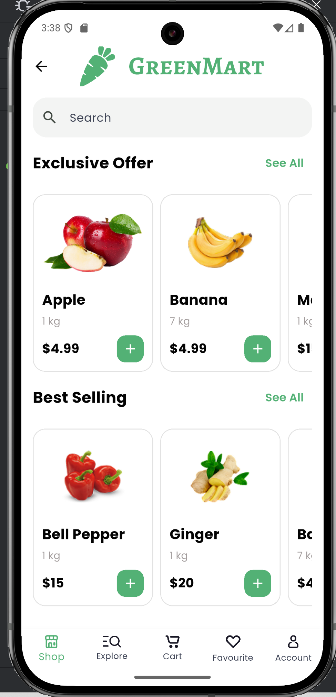
    </td>
    <td align="center">
      <b>Shop2 Screen</b>  
      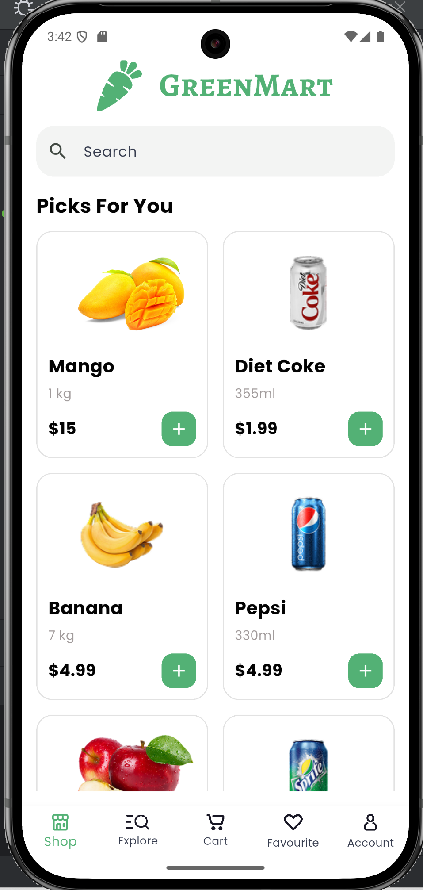
    </td>
  </tr>
</table>
###  ProductDetails Screens
<table align="center">
  <tr>
    <td align="center">
      <b>ProductDetails1 Screen</b>  
      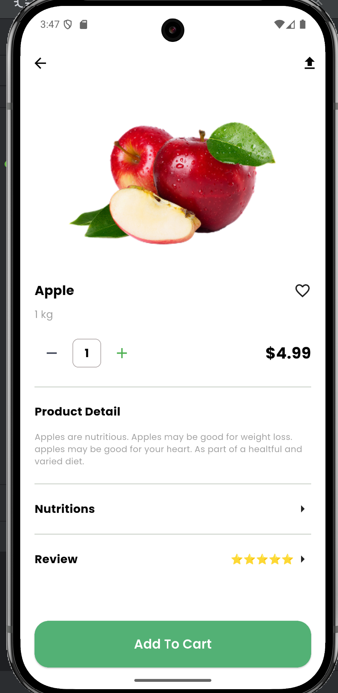
    </td>
    <td align="center">
      <b>ProductDetails2 Screen</b>  
      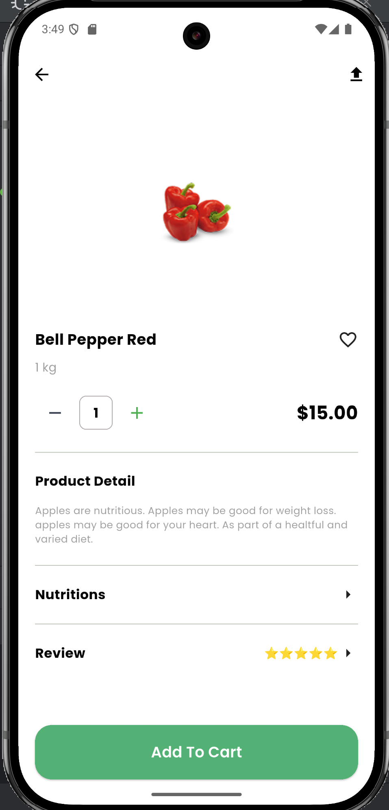
    </td>
    <td align="center">
      <b>ProductDetails3 Screen</b>  
      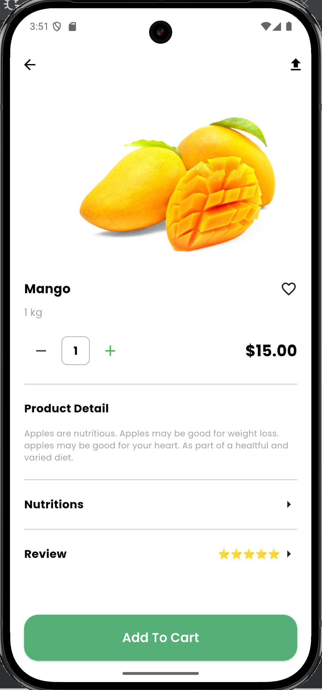
    </td>
  </tr>
</table>
###  Categories Screens
<table align="center">
  <tr>
    <td align="center">
      <b>Categories Screen</b>  
      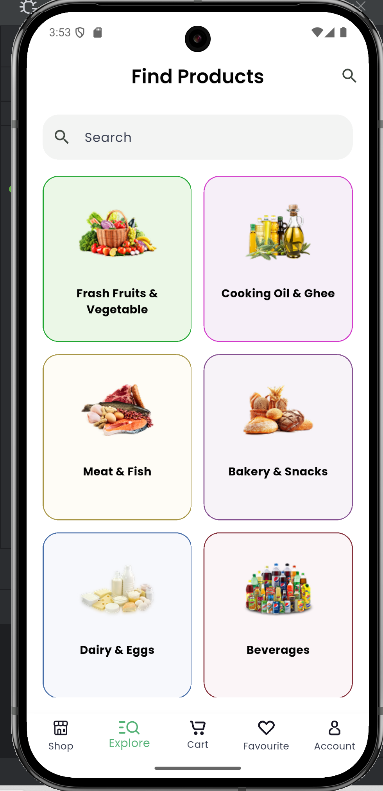
    </td>
    <td align="center">
      <b>CategoryProducts Screen</b>  
      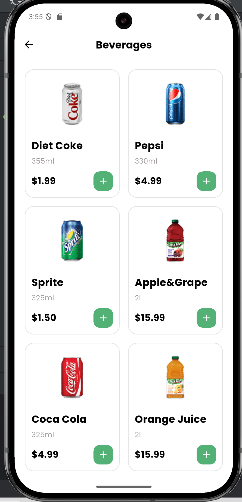
    </td>
    <td align="center">
      <b>CategoryProducts2 Screen</b>  
      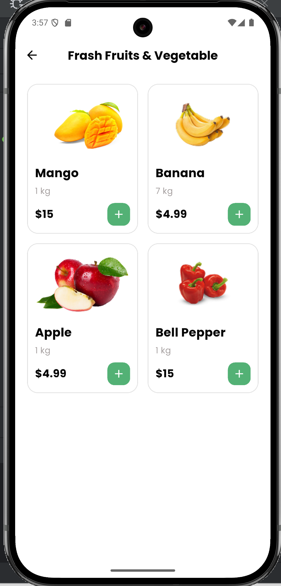
    </td>
    <td align="center">
      <b>search Screen</b>  
      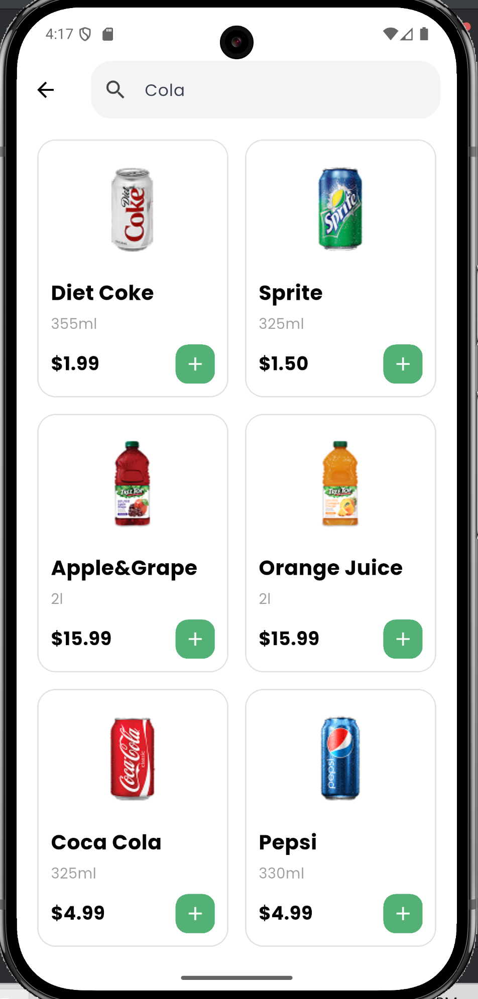
    </td>
  </tr>
</table>
###  Cart Screens
<table align="center">
  <tr>
    <td align="center">
      <b>Cart Screen</b>  
      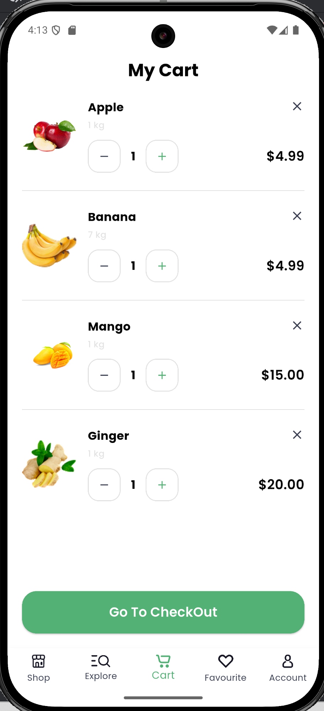
    </td>
    <td align="center">
      <b>sheetBottom Screen</b>  
      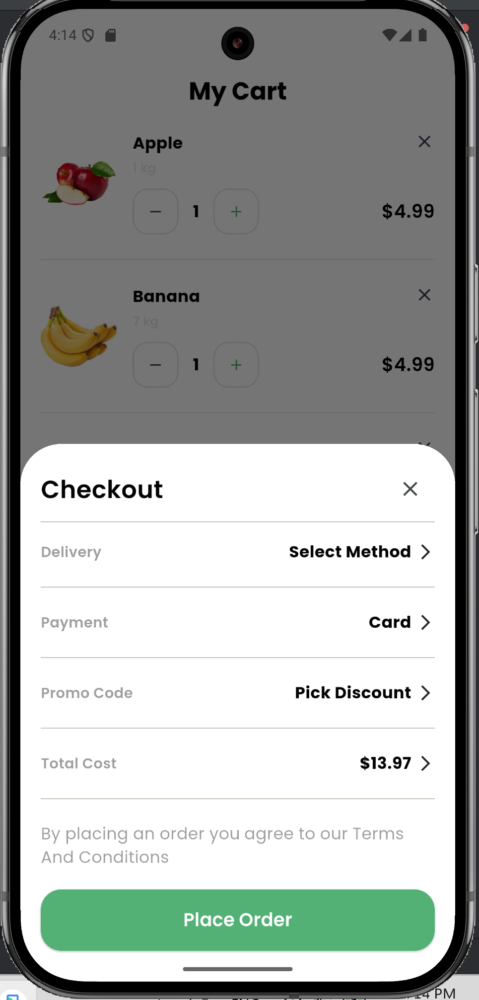
    </td>
    <td align="center">
      <b>Accepted Screen</b>  
      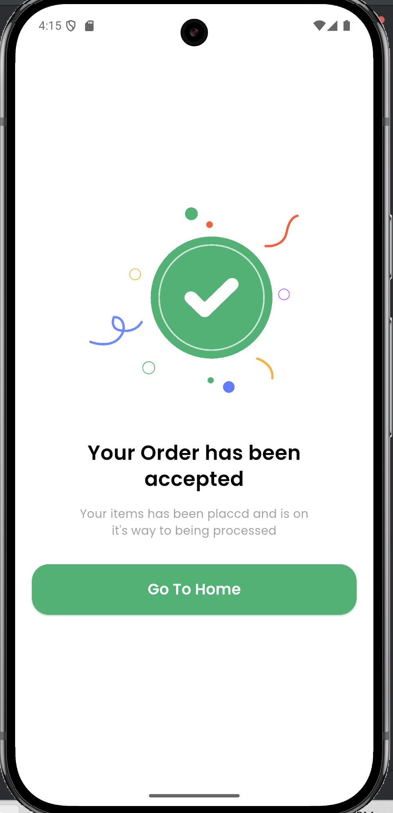
    </td>
  </tr>
</table>
###  Favourite Screen
<table align="center">
  <tr>
    <td align="center">
      <b>Favourite Screen</b>  
      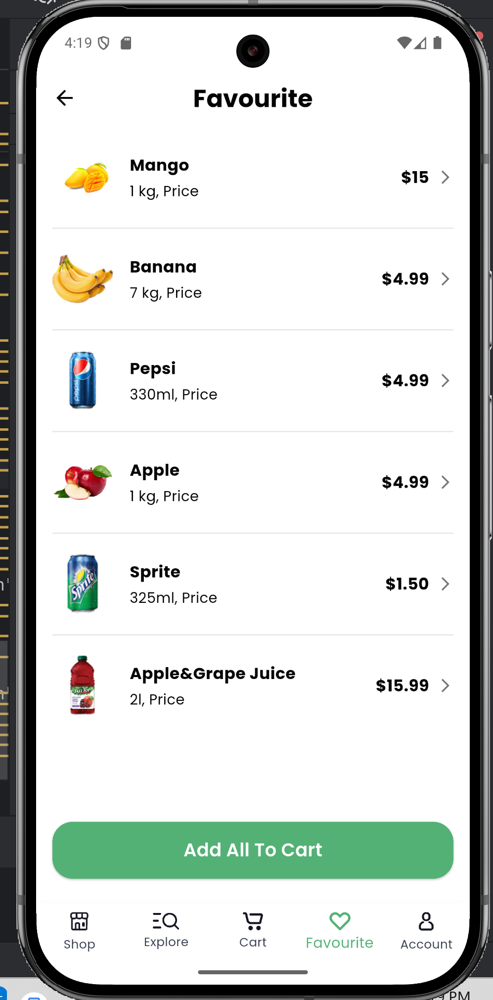
    </td>
  </tr>
</table>

